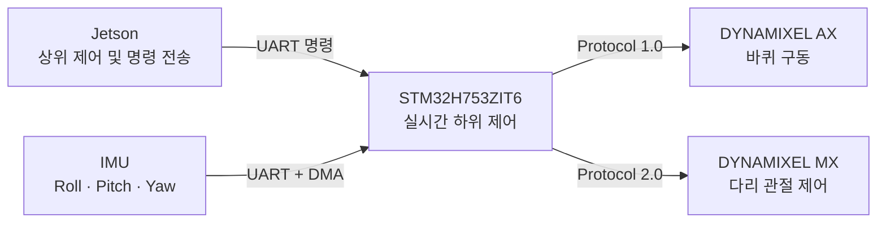

# WoKi Wheel-Legged Robot Firmware

STM32H753 기반 휠-레그 변형 로봇 **WoKi**의 하위 제어 펌웨어입니다.

Jetson으로부터 동작 명령을 수신하고, DYNAMIXEL 모터를 이용한 주행 및 자세 전환과 IMU 데이터 수집을 수행합니다.

## 프로젝트 개요

**WoKi (Wheels-on-Knees Integrated robot)는** 바퀴 주행과 다리 자세 전환이 가능한 휠-레그 로봇입니다.

이 저장소에는 다음 기능을 담당하는 STM32 펌웨어가 포함되어 있습니다.

- Jetson과 STM32 사이의 UART 명령 통신
- Wheel Mode 및 Leg Mode 전환
- 전진, 후진, 정지 및 탱크 회전 제어
- DYNAMIXEL Protocol 1.0 및 Protocol 2.0 통신
- 다수의 DYNAMIXEL 모터 동기 제어
- IMU 데이터의 DMA 기반 비동기 수신
- 모터 상태 및 IMU 데이터 조회
- 통신 오류와 비정상 상태 검출

## 시스템 구성



## 주요 기능

### 1. 로봇 주행 제어

Jetson 명령에 따라 다음 동작을 수행합니다.

- 전진 및 후진
- 정지
- 좌·우 탱크 회전
- Wheel Mode 전환
- Leg Mode 전환

모드 전환 중에는 중복 명령과 반대 모드 요청을 차단하여 연속 전환으로 인한 오작동을 방지합니다.

### 2. DYNAMIXEL 모터 제어

바퀴 모터와 다리 관절 모터의 서로 다른 프로토콜을 하나의 펌웨어에서 처리합니다.

- DYNAMIXEL Protocol 1.0 기반 바퀴 모터 속도 제어
- DYNAMIXEL Protocol 2.0 기반 다리 관절 위치 제어
- Sync Write를 이용한 다수 모터 동기 제어
- Torque Enable 및 구동 프로파일 설정
- 현재 위치, 속도, 전류 및 하드웨어 오류 조회
- Status Packet의 헤더, ID, 길이, CRC 및 상태 오류 검증

### 3. IMU 데이터 수신

IMU 데이터는 UART의 Receive-to-IDLE DMA 방식을 이용해 비동기로 수신합니다.

- Roll, Pitch, Yaw 데이터 파싱
- 수신 데이터 유효성 검사
- 마지막 수신 시각과 수신 순번 관리
- 파싱 오류 및 누락 프레임 횟수 확인
- 일정 시간 동안 새 데이터가 없을 경우 데이터 무효 처리
- 모터 통신과 IMU 수신의 동시 동작 지원

### 4. Jetson 통신

STM32는 Jetson으로부터 문자열 명령을 수신해 로봇을 제어하거나 센서 및 모터 상태를 반환합니다.

| 명령 | 기능 |
|---|---|
| `PING` | STM32 통신 상태 확인 |
| `GET_IMU` | 최신 IMU 데이터 조회 |
| `PING_MOTOR:<ID>` | 지정 모터의 통신 상태 확인 |
| `GET_MOTOR:<ID>` | 지정 모터의 현재 위치 조회 |
| `GET_MOTOR_VEL:<ID>` | 지정 모터의 현재 속도 조회 |
| `GET_MOTOR_CURRENT:<ID>` | 지정 모터의 현재 전류 조회 |
| `GET_MOTOR_ERROR:<ID>` | 지정 모터의 하드웨어 오류 조회 |
| `STOP` | 바퀴 정지 |
| `FWD` | 전진 |
| `BACK` | 후진 |
| `TL` | 좌측 탱크 회전 |
| `TR` | 우측 탱크 회전 |
| `WHEEL` | Wheel Mode 전환 |
| `LEG` | Leg Mode 전환 |

## 소스 코드 구조

```text
Core/
├── Inc/
│   ├── dxl_2_0.h
│   ├── imu_driver.h
│   ├── jetson_comm.h
│   └── robot_motion.h
│
├── Src/
│   ├── main.c
│   ├── dxl_2_0.c
│   ├── imu_driver.c
│   ├── jetson_comm.c
│   └── robot_motion.c
│
└── Startup/
    └── startup_stm32h753zitx.s

Drivers/
├── CMSIS/
└── STM32H7xx_HAL_Driver/
```

| 파일 | 역할 |
|---|---|
| `main.c` | 주변 장치와 기능 모듈 초기화 및 메인 실행 흐름 |
| `dxl_2_0.c` | DYNAMIXEL 패킷 생성, 송수신 및 상태 검증 |
| `imu_driver.c` | IMU DMA 수신, 데이터 파싱 및 유효성 관리 |
| `jetson_comm.c` | Jetson 명령 해석 및 응답 전송 |
| `robot_motion.c` | 주행과 Wheel/Leg 자세 전환 제어 |

## 개발 환경

| 항목 | 내용 |
|---|---|
| Board | NUCLEO-H753ZI |
| MCU | STM32H753ZIT6 |
| IDE | STM32CubeIDE |
| STM32CubeMX | 6.16.1 |
| Firmware Package | STM32Cube FW_H7 V1.12.1 |
| Language | C |
| Motor Communication | DYNAMIXEL Protocol 1.0 / 2.0 |
| Host Communication | UART |
| IMU Reception | UART Receive-to-IDLE DMA |

## 확인된 동작

현재 커밋 기록을 기준으로 다음 항목을 확인했습니다.

- Jetson과 STM32 사이의 `PING` 응답
- Jetson 요청 기반 IMU 데이터 조회
- IMU 데이터의 연속 DMA 수신
- 모터 Ping 및 상태 정보 조회
- IMU 수신과 모터 상태 조회의 동시 동작
- Wheel Mode 및 Leg Mode 자세 전환
- 전진, 후진, 정지 및 탱크 회전
- 전체 강제 빌드 오류 0개 및 경고 0개

## 저장소 관리

STM32CubeIDE가 자동 생성하는 다음 빌드 결과물은 Git에서 제외합니다.

- `Debug/`
- `Release/`
- PC 환경에 따라 변경되는 `language.settings.xml`

소스 코드와 프로젝트 설정 파일을 중심으로 버전 관리합니다.
